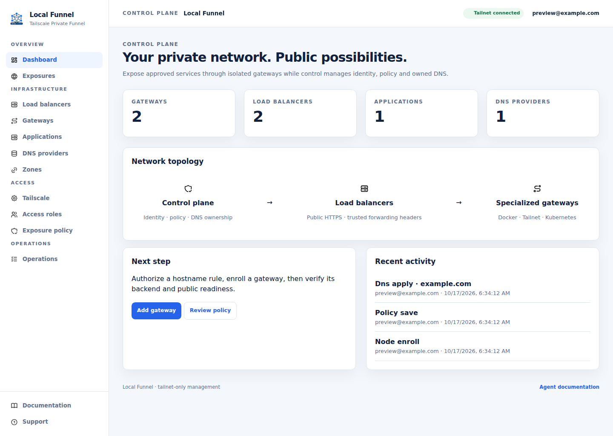
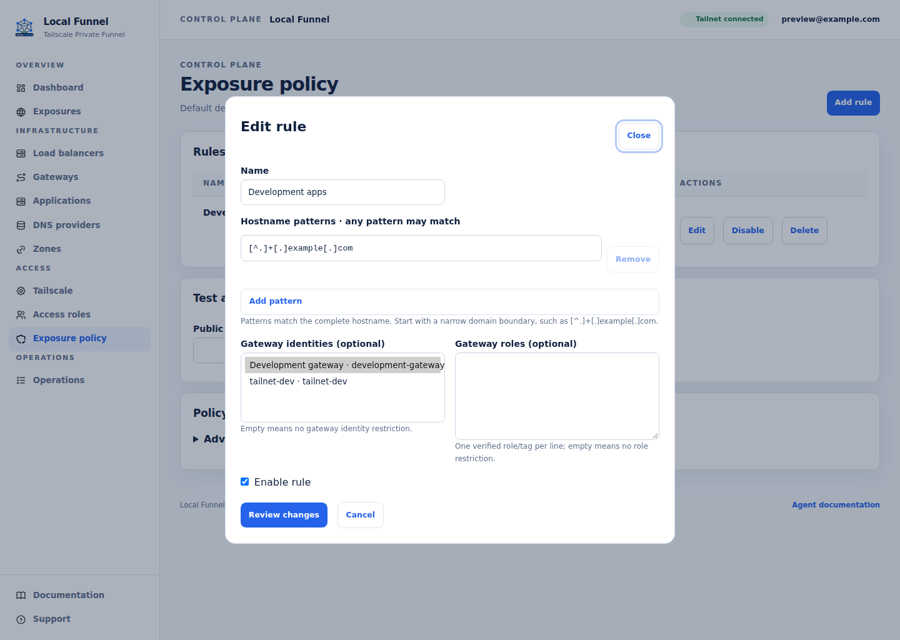
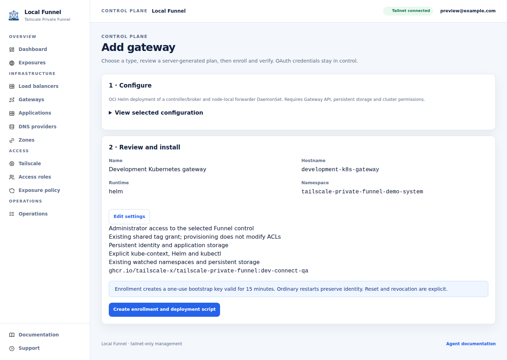
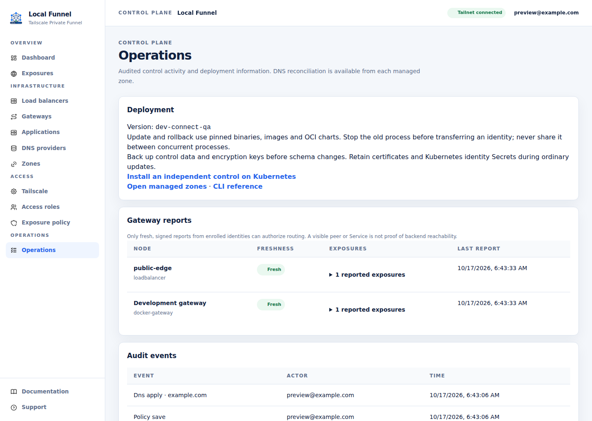
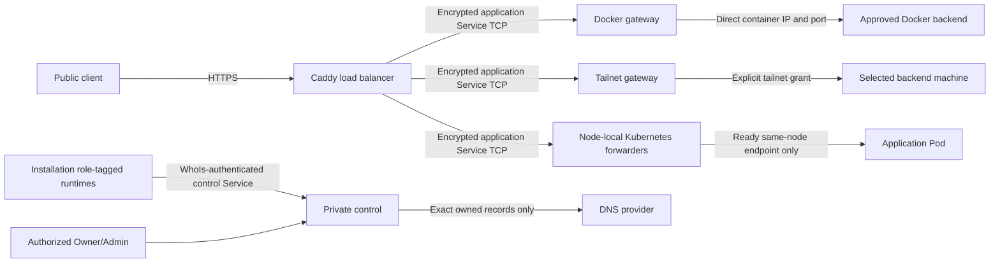

<div align="center">


# tailscale-private-funnel

**A self-hosted, policy-led public edge for services that stay on your Tailscale tailnet.**

[](https://github.com/tailscale-x/tailscale-private-funnel/releases)
[](https://github.com/tailscale-x/tailscale-private-funnel/actions/workflows/private-funnel.yml)
[](https://go.dev/)
[](https://ghcr.io/tailscale-x/tailscale-private-funnel)
[](https://github.com/tailscale-x/tailscale-private-funnel/actions)

</div>

Local Funnel keeps management private and exposes policy-authorized HTTP services
through a public Caddy edge. Control owns every DNS mutation and the exact ownership
ledger. Runtime authentication comes from verified Tailscale device-role tags.

**Runtime model:** verified Tailscale roles replace Funnel enrollment and component
signatures. Older enrollment-based runtimes are not compatible. Use matching
artifact versions for the generator, control, native services and Kubernetes operator.

## See the console

The control UI is designed for quick decisions: see the topology, check health,
review policy, and apply only the DNS records this installation owns.

| Dashboard | Policy and authorization |
| --- | --- |
|  |  |

| Gateway setup instructions | Ownership preview |
| --- | --- |
|  |  |

The dashboard makes the security boundary visible: the control plane owns policy and
DNS, the load balancer is the only public edge, and specialized gateways report only the
approved services they can reach. The hero capture is a 1440×1024 synthetic,
credential-free environment.

HTTP path routing supports Kubernetes PathPrefix and named Docker route labels, with optional prefix stripping or replacement at the shared Caddy edge. See [configuration and examples](docs/path-routing.md).

Runtime reports are accepted independently of external DNS and Tailscale API work, so API stalls do not consume healthy nodes' report leases. See [report acceptance and reconciliation](docs/report-reconciliation.md). Previously ready routes and owned DNS survive lost connectivity and negative health reports while configuration remains authorized. New routes still require readiness; explicit removal, policy denial, and revocation clean up owned resources.

For intermittent Service routing, see [bounded diagnostic events and log collection](docs/service-route-diagnostics.md). Missing connectivity never authorizes DNS deletion.

Docker container/label removal automatically retires registrations after a complete authenticated scan, allowing authorized Kubernetes reclamation without changing DNS ownership. See [registration lifecycle](docs/docker-registration-lifecycle.md).


## Network and authority



| Boundary | Enforcement |
|---|---|
| Installation | Five exact device-role tags and two separate Service tags per installation; no generated cross-installation grants |
| Human administration | Verified WhoIs plus separate human-role authorization; runtime tags never confer management permission |
| Runtime registration | Exact installation/role check; logical IDs are selectors, not secrets; bounded instance leases prevent competing writers |
| Exposure | Default-deny hostname policy, backend identity/reachability checks, fresh reports and load-balancer acknowledgment |
| Docker | Native supervisor holds Docker access; approved network/IP validation and direct forwarding; no relay, published host port, or additional HTTP proxy |
| Kubernetes | Pod-bound TLS key issuance; disposable network identities; forwarders have no Kubernetes API permissions and select only local ready endpoints |
| Host reuse | Borrowed daemon is never joined, retagged, renamed, logged out, or deleted; scoped Service ownership and ETags preserve unrelated configuration |
| DNS | Internal exact-owner ledger; unmanaged overwrites require explicit preview-bound approval; no TXT markers |

Devices sharing one installation role share its authority. Role tags are not a
per-process sandbox. Existing broad tailnet allows can weaken isolation: generated
policy cannot override earlier allows. Additional Tailnet backend access is an
explicit administrator-managed grant. Funnel never edits ACL policy.

See [role, credential and transport details](docs/TAILSCALE-ROLES.md).

## Start control

Download a matching binary from the [release artifacts](https://github.com/tailscale-x/tailscale-private-funnel/releases)
or build the development checkout locally. Start with:

```sh
tailscale-private-funnel native controls create main --installation main \
  --tailnet YOUR_TAILNET --version VERSION \
  --oauth-client-id-file /etc/funnel/installation-issuer-id \
  --oauth-client-secret-file /etc/funnel/installation-issuer-secret \
  --services-client-id-file /etc/funnel/services-id \
  --services-client-secret-file /etc/funnel/services-secret \
  --users-client-id-file /etc/funnel/users-id \
  --users-client-secret-file /etc/funnel/users-secret --output script > control.sh
sh control.sh
```

`create` generates an installer; it does not deploy. Credential file paths belong
on the execution machine. Use separate protected clients: installation-wide `auth_keys`,
`services` plus `devices:core:read` tagged with the installation control role
(which owns both Service tags), and `users:read`. The key issuer itself needs
only `auth_keys` and the installation issuer tag. The setup URL uses
`svc:tailscale-private-funnel-<installation>-control`'s MagicDNS FQDN, so disposable
control device addresses are not client configuration.

Open the private UI to configure providers, discovered zones, hostname policy,
and gateway/load-balancer instructions. Generated commands come from shared Go
renderers. The UI never receives kubeconfigs or SSH credentials.

[Installer workflow](docs/INSTALLER-WORKFLOW.md) · [Kubernetes](docs/KUBERNETES.md) ·
[PostgreSQL / CloudNativePG / Argo CD](docs/POSTGRESQL.md)

## Deployment choices

| Component | Native | Kubernetes | Durable state |
|---|---|---|---|
| Control | Embedded or existing-host Tailscale | Embedded ephemeral | Database and matching encryption material |
| Load balancer | Embedded or existing-host Tailscale | Embedded ephemeral | Caddy certificates |
| Docker gateway | Embedded or existing-host Tailscale | — | Native embedded identity and local inventory revision |
| Tailnet gateway | Embedded or existing-host Tailscale | — | Native embedded identity and local settings |
| Kubernetes gateway | — | Agent and forwarder DaemonSet, embedded ephemeral | Logical configuration remains in control |

Control currently requires embedded Tailscale. Native load balancers, Docker
gateways, and Tailnet gateways may reuse a connected host daemon. Tailscale 1.102.2
rejects PROXY v2 with Unix targets, so host-reused control is rejected before host
configuration changes rather than accepting unverified caller metadata.

Native embedded is the default and survives restarts. Host reuse carries no join
secret and requires a connected, suitably tagged daemon with LocalAPI permissions.
Kubernetes obtains fresh single-use ephemeral keys per verified Pod; it has no
identity Secrets or identity restoration. Native stop preserves state; disable/delete
withdraws owned Funnel resources. Remove role tags/devices in Tailscale to revoke
role authority.

## Routing

| Source | HTTP routing |
|---|---|
| Docker | Whole-host `tailscale-private-funnel.expose`; named routes support segment-boundary path prefixes and optional prefix replacement |
| Tailnet | UI-selected stable backend device and HTTP port through an authorized gateway |
| Kubernetes | GatewayClass/Gateway/HTTPRoute, ReferenceGrant and Ingress; supported exact/prefix paths, header/query/method matches, weighted backends, modifiers, redirects and prefix rewrite |

Caddy alone terminates public TLS and performs matching/rewriting. Gateways forward
raw TCP. Original Host, sanitized trusted forwarding headers, request bodies,
streaming, SSE and WebSockets retain the existing behavior. Rewrite does not change
response bodies, Location headers, or cookie paths; configure the application's
public base path where required. This is not full Gateway API conformance.

Removing a Docker container or forwarding label retires its routes only after a
complete authoritative inventory. Stopped containers, failed discovery, unreachable
backends and report expiry do not release hostname ownership. Shared routes keep
DNS while another authorized assignment remains.

## DNS providers

| Vendor | Runtime adapter | Domain discovery | Credential storage |
|---|---|---|---|
| Cloudflare | Supported | Paginated zone discovery | Encrypted, including account ID |
| GoDaddy | Supported | Paginated domains | Encrypted |
| Route 53 | Supported | Public hosted zones and configured restriction | Encrypted |
| Other catalog providers | Metadata only | Unavailable until intentionally linked | No active adapter |

One DNS provider can manage multiple vendor-discovered zones. Adding a zone does
not register a domain or change nameservers. Display names are editable; immutable
IDs bind references. DNS-only public A/CNAME records belong to the internal ledger.
No outside-owner record is deleted or overwritten without explicit approval.

## CLI and API

```text
tailscale-private-funnel native controls|gateways|loadbalancers ...
tailscale-private-funnel k8s operator|controls|gateways|loadbalancers ...
tailscale-private-funnel manage ...
```

Native lifecycle operations execute locally. Kubernetes operations require an
explicit context. Public `create` only renders an installer; no SSH or cluster
connection is made by the generator. `--output json`, non-mutating `--dry-run`,
target-side `--wait`, and destructive `--yes` are supported. There are no public
join, enrollment, approval, transfer/import, or compatibility commands.

The private `/llms.txt`, `/docs/cli.md`, `/docs/api.md` and OpenAPI reference are
generated from protobuf/Cobra metadata and live control settings. Agents can manage
Funnel through the same Tailscale-authorized CLI without opening a browser.

## Development and verification

```sh
npm ci --prefix ui
scripts/generate-rpc.sh
scripts/generate-operator.sh
npm run build --prefix ui
go test ./...
go test -tags caddy ./...
go vet ./...
git diff --check
```

Run PostgreSQL contracts against disposable PostgreSQL 16/18 databases and operator
contracts with the pinned envtest binaries. Real role-tag policy, Service auto-approval,
host-daemon source preservation, public TLS and Pod replacement require explicit
integration acceptance; local unit tests do not prove a live rollout. Build locally
or in CI. See the [v4.0.1 rollout evidence](docs/verification/v4.0.1-rollout.md)
and [fresh-name DNS fix](docs/verification/cloudflare-complete-names-20261019.md)
for deployed artifacts, routing checks, and the stable/development release boundary.
