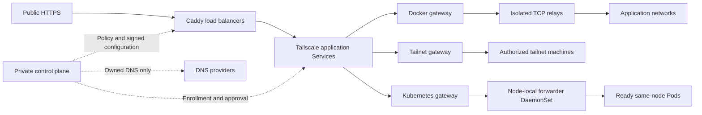

<div align="center">


# tailscale-private-funnel

**A self-hosted, policy-led public edge for services that stay on your Tailscale tailnet.**

[](https://github.com/tailscale-x/tailscale-private-funnel/releases)
[](https://github.com/tailscale-x/tailscale-private-funnel/actions/workflows/private-funnel.yml)
[](https://go.dev/)
[](https://ghcr.io/tailscale-x/tailscale-private-funnel)
[](https://github.com/tailscale-x/tailscale-private-funnel/actions)

</div>

Local Funnel keeps management private to your tailnet while making selected HTTP
services reachable through a public HTTPS load balancer. The control plane owns policy,
enrollment, signed gateway reports, and every DNS mutation.

```text
tailscale-private-funnel native controls|gateways|loadbalancers ...
tailscale-private-funnel k8s operator|controls|gateways|loadbalancers ...
tailscale-private-funnel manage ...
```

## See the console

The control UI is designed for quick decisions: see the topology, check health,
review policy, and apply only the DNS records this installation owns.

| Dashboard | Policy and authorization |
| --- | --- |
|  |  |

| Gateway setup instructions | Ownership preview |
| --- | --- |
|  |  |

The dashboard makes the security boundary visible: the control plane owns policy and
DNS, the load balancer is the only public edge, and specialized gateways report only the
approved services they can reach. The hero capture is a 1440×1024 synthetic,
credential-free environment.

## Architecture



The public edge is separate from backend discovery. Gateways use independent persistent
identities inside your shared-tag Tailscale policy; the application never edits ACLs.
Docker relays have no credentials or socket. The Kubernetes controller/broker manages identity Secrets only in its installation
namespace. Forwarders have no Kubernetes API permissions. Neither needs Docker, TUN,
or host networking.

## How it works

1. **Control joins the tailnet.** Run `native controls create` once; the service keeps its tsnet identity and serves the management UI on a private address.
2. **Policy and enrollment are created in the UI.** Administrators configure public load balancers, specialized gateways, hostname rules, and provider zones. Generated commands contain the exact release and paths to run.
3. **The load balancer terminates HTTPS.** Load balancer mode runs Caddy with the process's persistent tsnet transport. All backend types are reached through private Tailscale Services and their selected gateway.
4. **Gateways discover HTTP services.** Docker labels, tailnet-machine selection, and Kubernetes routing resources produce policy-authorized assignments and signed, expiring reports.
5. **Control distributes exposures and reconciles owned DNS.** The provider adapter creates owned A records for each exposure’s eligible load balancers, and removes only records in this installation's ledger. Unowned records need explicit overwrite approval.

## Quick start

Quick start only boots the control node. After the management UI is available,
use **Load balancers** or **Gateways → Add gateway** to generate complete
provisioning instructions. Enrollment begins when the CLI command runs. Those commands are generated from the selected policy,
release, hostname, tags, and storage paths; they are intentionally not
duplicated in this README.

### Spawn the control node

Create a Tailscale OAuth client with `auth_keys`, `devices:core`, `services`,
and **`users:read`**. Use `tag:tailscale-private-funnel` for device and Service
permissions. The read-only `users:read` scope lets control verify Tailscale
Owner/Admin roles for web UI access; it does not allow changing users or roles.
Store the client ID and secret in the protected files used below.

Release workflows publish ready-to-run binaries for Linux amd64, Linux arm64,
and macOS arm64. Use matching v3 binary, image, and operator chart versions.
The UI generates additional gateway and load-balancer instructions after control
starts; only control bootstrap needs local OAuth credential files.

Native deployments are system-level Linux services. Configuration is under
`/etc/tailscale-private-funnel/native`; owned identity/data directories are under
`/var/lib/tailscale-private-funnel/native`. Use explicit paths when needed.
Stop preserves identity and data; delete revokes access and removes owned state.
Open the private control URL, configure DNS providers and policy, then generate
node commands in the UI.

The control-only quick start is one command:

```sh
curl -fsSL https://raw.githubusercontent.com/tailscale-x/tailscale-private-funnel/v3.1.0/scripts/control.sh | sh -s -- --version v3.1.0 --tailnet example.ts.net --oauth-client-id-file ./ts-client-id --oauth-client-secret-file ./ts-client-secret
```

The helper downloads the release binary and verifies its checksum. Use
`--name` and `--hostname` to select the native control deployment handle and node
hostname. It leaves gateway and load-balancer provisioning to the web UI.

The unified CLI separates deployment infrastructure from installation management:

```sh
tailscale-private-funnel native controls create main \
  --version VERSION --tailnet example.ts.net \
  --oauth-client-id-file ./ts-client-id \
  --oauth-client-secret-file ./ts-client-secret --wait --output script > install-control.sh
sh install-control.sh
```

See [installer generation and execution](docs/INSTALLER-WORKFLOW.md) for native
and Kubernetes bootstrap, connectivity requirements, and credential handling.

## Security and ownership

Local Funnel is designed so a compromise of one application container does not become
control-plane access, a second Tailscale identity, or access to the rest of the
tailnet. Every Local Funnel node and Service uses the dedicated
`tag:tailscale-private-funnel` identity boundary. Your static Tailscale grants define access within that boundary. Funnel never changes
existing grants; additional access to other machines must be authorized by you.

| Boundary | Protection |
| --- | --- |
| Tailscale boundary | Bootstrap and application Services use `tag:tailscale-private-funnel`. Existing Tailscale policy defines its access boundary. Additional Tailnet gateway tags and grants for selected remote backends are assigned externally; the application never modifies ACLs. |
| Management | The UI is reachable only through the dedicated tailnet path. Every request is authorized from Tailscale `WhoIs`; administrator, operator, and viewer roles are explicit. |
| Enrollment | OAuth credentials stay in control. Generated bootstrap keys are short-lived, one-use, preauthorized, and never written to node state or systemd units. |
| Gateway identity | One persistent tsnet identity owns the node's Services. Reports are Ed25519 signed, nonce checked, freshness limited, and bound to that enrolled identity. |
| Docker reachability | The docker-gateway supervisor is the only process with Docker socket access. It attaches credential-free relay containers to selected user-defined application networks and publishes only loopback relay ports. Relays have no Docker socket or Tailscale state. |
| Service access | Control approves the exact Service/device pair and sends only policy-filtered configuration to the selected gateway. Policy-authorized labels automatically provision application Services; denied labels remain stopped. |
| Public edge | Caddy terminates public TLS at the load balancer and dials the approved private Service over the load balancer's persistent tsnet transport. Backends are never published directly. |
| DNS | The internal ledger is authoritative. The control plane changes or deletes only records owned by its exact ledger owner. Unowned records require an explicit preview approval before overwrite. |

The DNS provider does not need to trust a user-supplied TXT marker for safety. The
provider account, encrypted control database, ownership ledger, and explicit approval
flow form the authorization boundary. No DNS-side TXT ownership markers are created.

## Providers and releases

Provider support is shown in the control UI with capability and test status. Provider
credentials are encrypted at rest and are used only by the control service's adapter.
They are never rendered into pages or generated enrollment commands.

| Provider | Runtime adapter | Record support | Status |
| --- | --- | --- | --- |
| Cloudflare | Available | A, CNAME | Supported; primary provider |
| GoDaddy | Available | A, CNAME | Supported |
| Amazon Route 53 | Available | A, CNAME | Supported |
| Other pinned libdns providers | Metadata only | Catalog-dependent | Visible as unavailable until an adapter is linked |

Image tags are immutable release inputs. Replace `vX.Y.Z` below with a published
release tag. To roll back, use `native … update` or `k8s … update` with the prior pinned
version. Restore matching control data and identity backups if the schema changed:

The Docker image is a thin distroless wrapper around the matching release
binary. CI builds each target once, then packages that artifact for the native
image architecture.

```sh
docker pull ghcr.io/tailscale-x/tailscale-private-funnel:vX.Y.Z
docker run --rm ghcr.io/tailscale-x/tailscale-private-funnel:vX.Y.Z version
```

See the [latest release](https://github.com/tailscale-x/tailscale-private-funnel/releases),
[private-funnel operations guide](PRIVATE_FUNNEL.md), and [architecture diagram](docs/architecture.svg).

## Development

```sh
npm ci --prefix ui
npm run build --prefix ui
scripts/generate-rpc.sh
go test ./...
go test -tags caddy ./...
go vet ./...
mkdir -p dist
GOOS=linux GOARCH=amd64 CGO_ENABLED=0 go build -tags caddy -trimpath -o dist/tailscale-private-funnel-linux-amd64 ./cmd/tailscale-private-funnel
docker build --file Dockerfile --tag private-funnel:dev .
```

Builds, screenshots, checksums, and multi-architecture images are published by
the tag workflow. The VPS only pulls those prebuilt artifacts.

### Policy-controlled Docker discovery

Configure an exposure policy once, then add `tailscale-private-funnel.expose=5173:app.example.com:http` to a container. Control validates the enrolled docker-gateway identity, hostname policy, managed zone, and hostname/port conflicts before creating its application and Tailscale Service. Applications are an operational inventory, not a second approval step. DNS ownership and explicit overwrite rules still apply.

The default administrator selector is `autogroup:owner`, verified through a server-side Users API lookup (`users:read` OAuth scope); no individual user allowlist is required. Other account roles require an explicit selector grant. Tagged nodes do not inherit human account roles. Other principals use configured viewer/operator/admin selectors or application capabilities.

### Expose an existing tailnet machine

Use **Expose a tailnet machine** in the control UI: choose a Tailnet gateway and backend,
enter an HTTP port and public hostname, test connectivity from that gateway, then save. Additional
backend access is granted externally through Tailscale tags and policy; this app
never broadens ACLs. Machines are selected by stable device identity, and a visible
peer still needs to pass the gateway-side port test. Control creates an application
Tailscale Service; ingress traffic goes through the selected Tailnet gateway.
[Workflow details](PRIVATE_FUNNEL.md#tailnet-gateway).

### Editable names, stable references

DNS provider, node, enrollment, application, and rule names are display labels.
Renaming them does not change credentials, Tailscale identities, Service names,
DNS domains, or record ownership. Selectors submit immutable IDs and show context
to distinguish duplicate names. Renaming a resource does not modify its operational hostname.

## Gateway provisioning

Open **Gateways → Add gateway** in the control UI. Choose Docker, Tailnet or Kubernetes
and follow the generated, type-specific installation instructions. Kubernetes uses the [cluster operator](docs/KUBERNETES.md) and component CRs;
Docker and Tailnet gateways use native systemd services. Control automatically assigns
load balancers—there are no gateway-side load-balancer IDs.

See [operations and supported
Kubernetes routing](PRIVATE_FUNNEL.md) for the feature matrix, annotations, persistence,
and rollback instructions. See the [v3.1.0 release notes](docs/releases/v3.1.0.md) for breaking changes and verification limits.

### Kubernetes deployment

Install the [Kubernetes operator](docs/KUBERNETES.md) once per cluster with the
OCI Helm chart. Create controls, load balancers and gateways as typed CRs with
installers generated by `k8s … create --context CLUSTER --output script`, executed
on a machine with cluster access. Each installation has one namespace.
Control/load balancers use Recreate Deployments and Secret-backed identities;
PVCs hold SQLite and certificates. Gateways use a broker and node-local forwarder
DaemonSet. Forwarders have no Kubernetes API permissions.

## Agent and CLI management

v3.0.0 introduces the generated Connect interface, executable provisioning, and
Kubernetes operator. It replaces the v2 command surface without compatibility aliases.

The browser and CLI use generated Connect contracts. Infrastructure commands are
separate from installation management:

| Namespace | Purpose |
|---|---|
| `native controls/gateways/loadbalancers` | Generate installers; inspect/update/delete local services; start/stop/restart/logs |
| `native/k8s … create` | Generate an authorized installer; execute the output on the target |
| `k8s operator` | Generate operator installers; inspect/update/remove the cluster operator |
| `k8s controls/gateways/loadbalancers` | Manage component CRs with explicit context |
| `manage` | Authorized providers, zones, policies, enrollment, nodes, exposures, settings and access |

```sh
tailscale-private-funnel manage whoami --control-url http://CONTROL:8080
tailscale-private-funnel native gateways create site-tailnet \
  --type tailnet --control-url http://CONTROL:8080 --version VERSION \
  --output script | ssh ubuntu@TARGET 'sh -s'
```

UI **Generate instructions** actions are read-only. Enrollment begins when the
CLI create runs on an authorized machine; installation begins only when its output is executed. The browser never uploads kubeconfigs or executes deployment.
Use `--output json`, `--dry-run`, `--wait`, and explicit `--yes` for deletion.
Control hosts dynamic `/llms.txt` with matching binary downloads, checksum/install
guidance, the configured control URL, and executable CLI examples. Generated CLI
help is at `/docs/cli.md`; `/docs` provides interactive API documentation. See [API and CLI architecture](docs/API.md).

### Maintenance continuity

Kubernetes forwarders preserve already-authorized traffic during short control updates within the five-minute
configuration window. New enrollment still requires control. Invalid signatures,
revocation, lost ownership leases and expired configuration fail closed.
See [Kubernetes update behavior](docs/KUBERNETES.md#control-updates-and-bounded-forwarding-continuity).

Release validation and limitations: [control-update acceptance](docs/qa-control-update-continuity.md).
