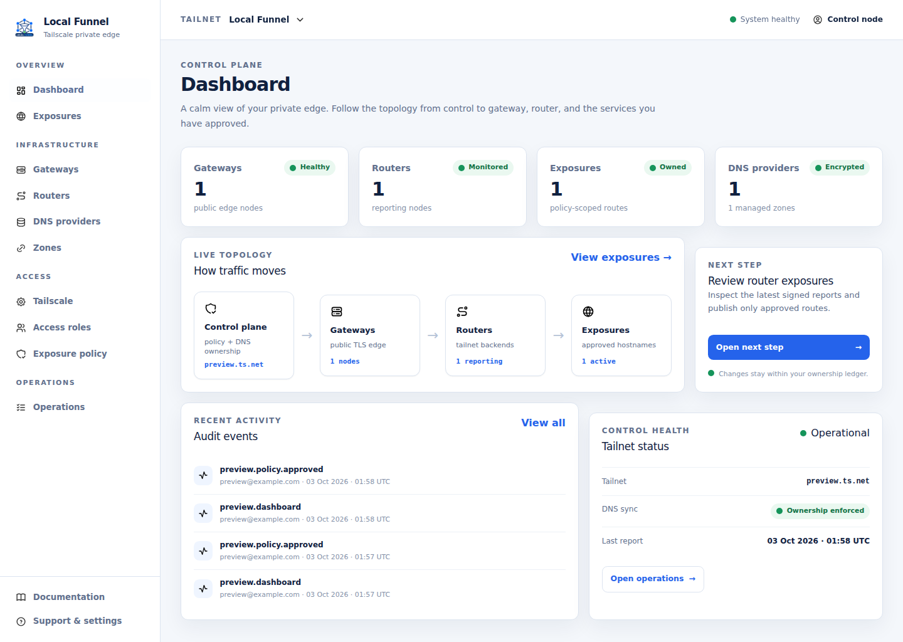
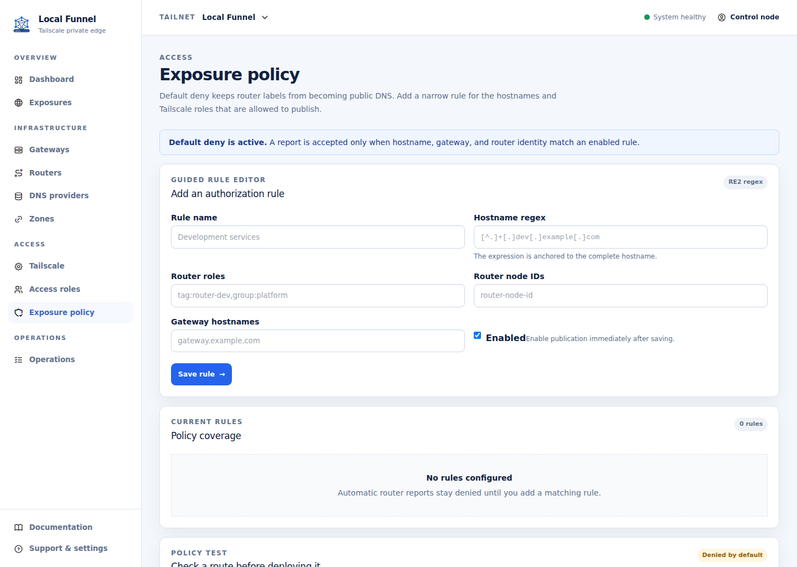
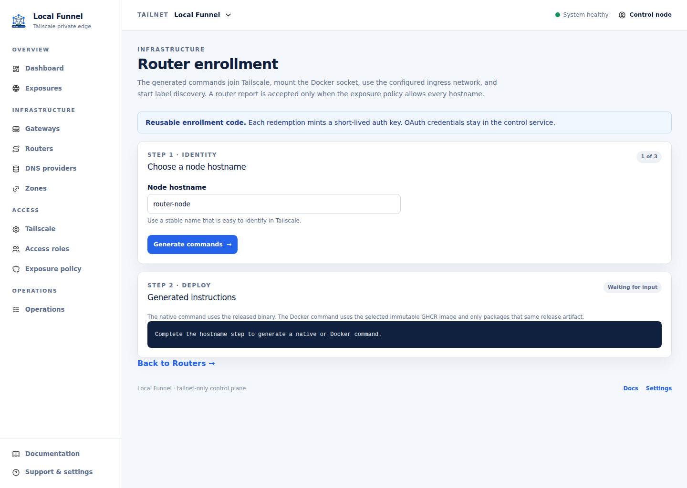
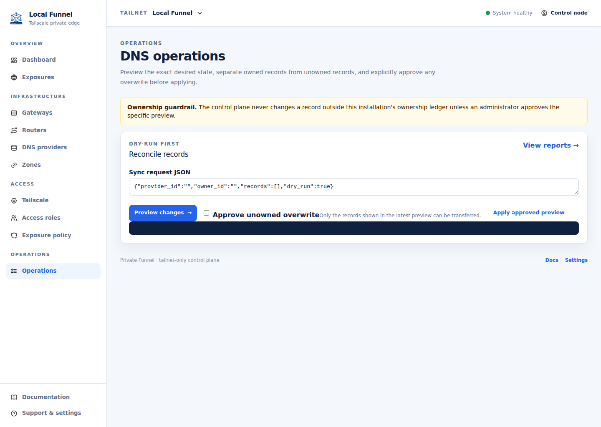
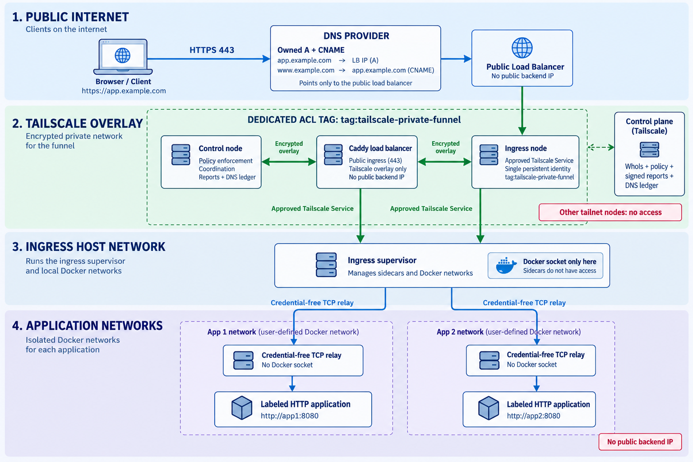

<div align="center">


# tailscale-private-funnel

**A self-hosted, policy-led public edge for services that stay on your Tailscale tailnet.**

[](https://github.com/tailscale-x/tailscale-private-funnel/releases)
[](https://github.com/tailscale-x/tailscale-private-funnel/actions/workflows/private-funnel.yml)
[](https://go.dev/)
[](https://ghcr.io/tailscale-x/tailscale-private-funnel)
[](https://github.com/tailscale-x/tailscale-private-funnel/actions)

</div>

Local Funnel keeps management private to your tailnet while making selected HTTP
services reachable through a public HTTPS load balancer. The control plane owns policy,
enrollment, signed ingress reports, and every DNS mutation.

```text
tailscale-private-funnel control ...
tailscale-private-funnel loadbalancer ...
tailscale-private-funnel ingress ...
```

## See the console

The control UI is designed for quick decisions: see the topology, check health,
review policy, and apply only the DNS records this installation owns.

| Dashboard | Policy and authorization |
| --- | --- |
|  |  |

| Enrollment command | Ownership preview |
| --- | --- |
|  |  |

The dashboard makes the security boundary visible: the control plane owns policy and
DNS, the load balancer is the only public edge, and ingress nodes report only the
approved services they can reach. The hero capture is a 1440×1024 synthetic,
credential-free environment.

## Architecture

The architecture is shown as network layers: public DNS and HTTPS at the edge, the dedicated Tailscale ACL overlay, the ingress host network, and isolated application networks.

<p align="center"></p>

## How it works

1. **Control joins the tailnet.** Run `control join` once; the service keeps its tsnet identity and serves the management UI on a private address.
2. **Policy and enrollment are created in the UI.** Administrators choose load balancers, ingress nodes, hostname rules, provider zones, and ownership IDs. Generated commands contain the exact release and paths to run.
3. **The load balancer terminates HTTPS.** Load balancer mode runs Caddy with the process's persistent tsnet transport and routes each approved hostname to its private Tailscale Service.
4. **Ingress reports labeled HTTP services.** Ingress watches the consolidated `tailscale-private-funnel.expose` label, starts one isolated raw TCP sidecar per backend port, and sends signed, expiring desired-state reports.
5. **Control reconciles owned DNS.** The provider adapter creates the owned load balancer A record and public CNAMEs, and removes only records in this installation's ledger. Unowned records need explicit overwrite approval.

## Quick start

Quick start only boots the control node. After the management UI is available,
use **Load balancers** or **Ingress** to create an enrollment and copy the complete
provisioning command. Those commands are generated from the selected policy,
release, hostname, tags, and storage paths; they are intentionally not
duplicated in this README.

### Spawn the control node

Release workflows publish ready-to-run binaries for Linux amd64, Linux arm64,
and macOS arm64. This one-line bootstrap downloads and verifies the matching
binary, creates a short-lived node key from protected OAuth files, and starts the
tailnet-only management UI:

```sh
curl -fsSL https://raw.githubusercontent.com/tailscale-x/tailscale-private-funnel/main/scripts/control.sh | sh -s -- --version vX.Y.Z --tailnet example.ts.net --oauth-client-id-file "$HOME/.config/tailscale-private-funnel/ts-client-id" --oauth-client-secret-file "$HOME/.config/tailscale-private-funnel/ts-client-secret"
```

The default state and data locations follow XDG conventions. Pass
`--state-dir`, `--data-dir`, or `--install-dir` when a system service needs
explicit paths. Open the private setup URL printed by `control join`, then
configure providers, zones, ownership IDs, access roles, exposure policy, and
node enrollments there.

## Security and ownership

Local Funnel is designed so a compromise of one application container does not become
control-plane access, a second Tailscale identity, or access to the rest of the
tailnet. Every Local Funnel node and Service uses the dedicated
`tag:tailscale-private-funnel` identity boundary. The ACL grants access only within
that tag's policy; existing tailnet nodes and services are outside the trust boundary.

| Boundary | Protection |
| --- | --- |
| Tailscale boundary | Control, load balancer, ingress, and Services use only `tag:tailscale-private-funnel`. The ACL grants this tag the required paths and denies access to unrelated tailnet nodes by default. |
| Management | The UI is reachable only through the dedicated tailnet path. Every request is authorized from Tailscale `WhoIs`; administrator, operator, and viewer roles are explicit. |
| Enrollment | OAuth credentials stay in control. Generated bootstrap keys are short-lived, one-use, preauthorized, and never written to node state or systemd units. |
| Ingress identity | One persistent tsnet identity owns the node's Services. Reports are Ed25519 signed, nonce checked, freshness limited, and bound to that enrolled identity. |
| Docker isolation | The supervisor is the only process with Docker socket access. Each forwarding relay has no socket, no Tailscale state, no auth key, no elevated capability, and only the selected application networks. |
| Service access | Control approves the exact Service/device pair and sends only policy-filtered configuration to the ingress node. Unknown applications and labels remain stopped. |
| Public edge | Caddy terminates public TLS at the load balancer and dials the approved private Service over the load balancer's persistent tsnet transport. Backends are never published directly. |
| DNS | The internal ledger is authoritative. The control plane changes or deletes only records owned by its exact ledger owner. Unowned records require an explicit preview approval before overwrite. |

The DNS provider does not need to trust a user-supplied TXT marker for safety. The
provider account, encrypted control database, ownership ledger, and explicit approval
flow form the authorization boundary. A DNS-side marker can be added later as a
recovery hint, but it never grants overwrite permission by itself.

## Providers and releases

Provider support is shown in the control UI with capability and test status. Provider
credentials are encrypted at rest and are used only by the control service's adapter.
They are never rendered into pages or generated enrollment commands.

| Provider | Runtime adapter | Record support | Status |
| --- | --- | --- | --- |
| Cloudflare | Available | A, CNAME | Supported; primary provider |
| GoDaddy | Available | A, CNAME | Supported |
| Amazon Route 53 | Available | A, CNAME | Supported |
| Other pinned libdns providers | Metadata only | Catalog-dependent | Visible as unavailable until an adapter is linked |

Image tags are immutable release inputs. Replace `vX.Y.Z` below with a published
release tag. To roll back, stop the current containers and pull the prior
immutable tag, then restore the control data backup if the schema changed:

The Docker image is a thin distroless wrapper around the matching release
binary. CI builds each target once, then packages that artifact for the native
image architecture.

```sh
docker pull ghcr.io/tailscale-x/tailscale-private-funnel:vX.Y.Z
docker run --rm ghcr.io/tailscale-x/tailscale-private-funnel:vX.Y.Z version
```

See the [latest release](https://github.com/tailscale-x/tailscale-private-funnel/releases),
[private-funnel operations guide](PRIVATE_FUNNEL.md), and [architecture diagram](docs/architecture.svg).

## Development

```sh
npm ci --prefix ui
npm run build --prefix ui
go run github.com/a-h/templ/cmd/templ@v0.3.1020 generate ./internal/web/ui
go test ./...
go test -tags caddy ./...
go vet ./...
mkdir -p dist
GOOS=linux GOARCH=amd64 CGO_ENABLED=0 go build -tags caddy -trimpath -o dist/tailscale-private-funnel-linux-amd64 ./cmd/tailscale-private-funnel
docker build --file Dockerfile --tag private-funnel:dev .
```

Builds, screenshots, checksums, and multi-architecture images are published by
the tag workflow. The VPS only pulls those prebuilt artifacts.
