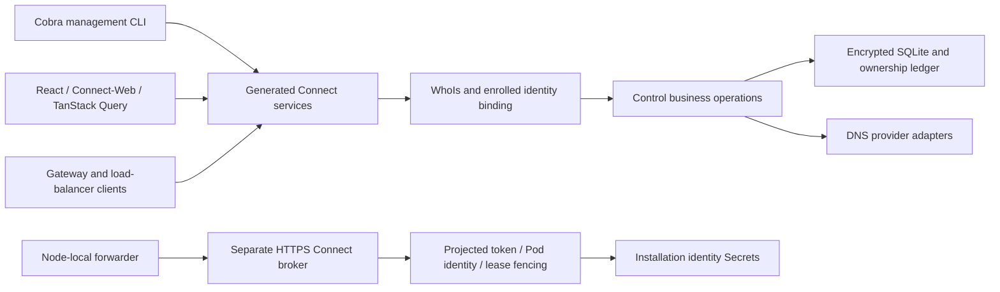

> Historical Connect migration evidence. Current commands and deployment contracts are in [API.md](API.md) and [KUBERNETES.md](KUBERNETES.md). Old provision/resume examples below are not current CLI.

# Connect management and executable provisioning

This is development work after v2.0.0. No stable tag or GitHub release is created
by this migration. All components must be updated together: the old REST and
broker JSON endpoints have been removed rather than retained as compatibility APIs.

## One contract family

`api/funnel/v1` defines management, provisioning, enrolled-node, enrollment, and
installation-broker services. Buf generates Go handlers/clients, TypeScript
clients, and OpenAPI. Method options declare permissions, CLI paths, audit
behavior, sensitive operations, and signed-payload models. Protovalidate applies
the declared input constraints; unknown JSON fields are rejected.

The data plane remains Caddy plus private Tailscale Services and raw TCP
forwarding. HTTP streams and WebSockets do not traverse RPC.

Management uses verified WhoIs roles. Tagged agents need an explicit management
role; they do not inherit human Owner/Admin privileges. Runtime methods bind the
verified caller to its enrolled identity. Signed payloads preserve their exact
bytes, verify signatures before decoding their declared protobuf model, and
retain purpose, freshness, nonce, revocation, and policy checks. The broker
retains its separate TLS, projected-token, Pod ownership, and lease boundary.

## CLI execution

Use `control --help`, `control whoami`, `control health`, and `--output json`.
The control publishes generated CLI help, API reference, and OpenAPI through
`/llms.txt`, `/docs/cli.md`, `/docs/api.md`, and `/docs`.

- `control provision plan MODE --target ...` resolves choices without enrollment
  or target mutation.
- `control provision apply MODE --target ... --yes` preflights the target, creates
  enrollment, installs verified artifacts, and waits for verified readiness.
- `control provision resume --receipt PATH --yes` resumes an already-bound
  deployment without creating or replaying credentials.

Local provisioning requires Linux and root or noninteractive sudo. It refuses
to overwrite existing identity, system services, or containers. Native system
services execute a root-owned, versioned binary under `/usr/local/lib`.
Kubernetes requires an explicit context, verifies installation ownership, uses
an OCI chart and an external temporary bootstrap Secret, and waits for both the
controller Deployment and forwarder DaemonSet. Resume verifies the stored
identity before repairing runtime resources.

The browser displays Go-generated instructions. CLI execution uses structured
Go actions and never evaluates returned shell text. Credentials travel through
protected files, stdin, temporary environment, or a dedicated Kubernetes Secret;
Helm values and private XDG receipts contain no bootstrap or OAuth secrets.
Partial failures preserve existing identity and require explicit recovery.

## Code-surface accounting

Run `python3 scripts/code-surface.py`; use `--ref COMMIT` for a historical baseline.
The checked-in baseline is commit `724e77a783f7f1ccddbe2391bdd1e679151d90f1`.
UTF-8 bytes and nonblank lines are both reported because the old HTML was embedded
in long Go string literals while the React code is formatted across many lines.
Generated clients, OpenAPI, bundled assets, tests, and documentation are reported
separately. Lockfiles, dependencies, binaries, and measurement outputs are excluded.

The authored Go server interface shrank by roughly 38% in bytes and 31% in lines.
Manual HTTP request construction fell from 29 sites to 18; remaining sites include
external provider/Tailscale operations and artifact downloads. The combined web
interface and client source is approximately flat in bytes. The overall authored
surface grew because this work also adds a full management CLI, executable
provisioning/recovery, and explicit contracts. There is no claim of an overall
repository line-count reduction.

See [baseline](metrics/rpc-baseline.json), [current measurements](metrics/rpc-current.json),
and [verification evidence](qa-connect-migration.md).

## Builds and rollout

`scripts/build-artifacts.sh VERSION linux-amd64` builds with `CGO_ENABLED=0` and
rejects Linux binaries with a dynamic interpreter. The distroless Dockerfile
packages that same prebuilt executable. CI regenerates contracts and UI assets,
checks drift, tests/vets both Go builds, and validates image startup. Version-tag
publication still owns multi-architecture images and native release artifacts.

Preserve SQLite, encryption keys, identity Secrets, and Caddy storage. Stop an old
identity owner before starting its replacement. A live migration must account for
every enrolled runtime client and installation broker, including controllers in
other clusters; leaving old clients behind would expire their reports.

The subsequent [fleet rollout](qa-connect-live-rollout.md) moved control to the
`dlkn` cluster and restored native-only Funnel workloads on xvps and Tiny.
